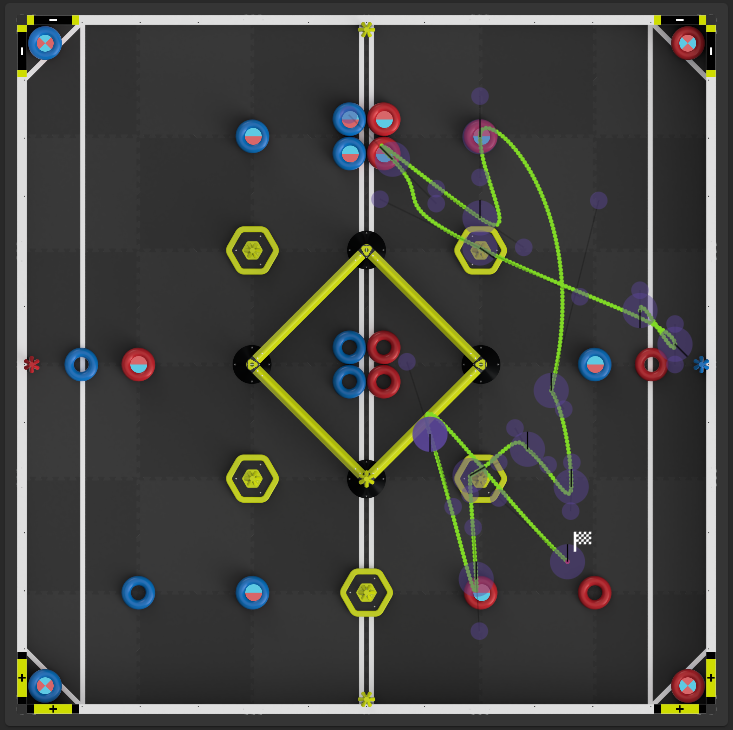

# Team 23083Z Reaper — PAS-VEX Signature Event 2025

[繁體中文版](README.zh-TW.md)

Competition code used by **Team 23083Z Reaper** at the **2025–2026 PAS-VEX V5RC Signature Event: High School** for the VEX V5 Robotics Competition game *Push Back*.

The event was held at Pacific American School in Hsinchu, Taiwan, from December 18–20, 2025. Team 23083Z finished qualifications **5–3–0**, advanced to the Round of 16, and received the **Create Award**. See the [official event page](https://events.vex.com/robot-competitions/vex-robotics-competition/RE-V5RC-25-0121.html) and [event results](https://events.vex.wang/event.php?id=60121&team=128435).

This repository is a historical competition snapshot. It preserves the code as used around the event, including experimental routines and tuning values that are specific to this robot.



## Highlights

- Six-motor tank drivetrain built on [JAR-Template](https://github.com/JacksonAreaRobotics/JAR-Template)
- Touchscreen autonomous selector and live diagnostics dashboard
- Encoder and IMU-based odometry with configurable starting pose
- Coordinate-based movement with `driveToXY()` and `turnToXY()`
- Cosine velocity profiles for smoother acceleration and deceleration
- Manual path recording with waypoint output to the terminal
- Alliance-color detection and opponent-block rejection using optical sensors
- Multiple match, AWP, and skills autonomous routines

## Software stack

| Component | Use in this project |
| --- | --- |
| VEXcode V5 C++ | Competition runtime, device APIs, build, and deployment |
| JAR-Template | Chassis PID, turning, driving, and base odometry utilities |
| Custom odometry layer | Pose tracking, coordinate movement, path recording, and debug displays |

## Program flow

1. `pre_auton()` initializes the robot, calibrates the IMU, and opens the Brain touchscreen autonomous selector.
2. `autonomous()` starts the odometry task, sets the alliance color, and dispatches the selected routine.
3. `usercontrol()` switches to tank drive and starts the intake, optical-sensor, and status tasks.

The competition callback registration is in `src/main.cpp`; field routes are kept in `src/autons.cpp` so mechanism control and strategy can be tuned separately.

## Autonomous system

The selector exposes the following entries:

| Entry | Purpose |
| --- | --- |
| `Right_43` | Right-side 4+3-block match route |
| `Left_43` | Left-side 4+3-block match route |
| `Right_7` | Right-side seven-block route |
| `Left_7` | Left-side seven-block route |
| `Solo` | Solo/AWP-oriented route |
| `Skills` | Robot Skills route |
| `Record` | Manual waypoint recording mode |
| `blank1`–`blank3` | Test or reserve slots |

Autonomous routines contain event-specific distances, headings, delays, and pneumatic timing. They should not be expected to work on another robot without retuning.

## Odometry and movement

`src/odometry.cpp` contains the custom navigation layer:

- `set_robot_pose(x, y, heading)` resets the estimated field pose and aligns the IMU offset.
- `get_robot_pose()` returns the current X position, Y position, and heading.
- `odometry_task()` updates the pose continuously from left/right drive encoder travel and IMU heading.
- `driveToXY(targetX, targetY, maxV, turnMaxV)` calculates the distance and bearing to a field coordinate, then controls forward motion and heading together.
- `turnToXY(targetX, targetY, turnMaxV)` turns the chassis to face a coordinate.
- `cos_move_distance_smooth()` and `cos_move_distance_fused()` use cosine-shaped velocity profiles to reduce abrupt starts and stops.
- `recordPath()` lets a driver save waypoints with controller button A and finish with button B. The generated coordinates are printed to the terminal for transfer into an autonomous routine.

Coordinate convention used by this code:

- `0°` points along the configured forward Y direction.
- `90°` points along positive X.
- Distances are expressed in inches unless a function states otherwise.

## Hardware configuration

The values below are taken directly from `src/robot-config.cpp`.

### Smart ports

| Device | Port | Notes |
| --- | ---: | --- |
| Left drive `L1`, `L2`, `L3` | 18, 17, 19 | 6:1 cartridges; software reversals are configured in code |
| Right drive `R1`, `R2`, `R3` | 7, 9, 8 | 6:1 cartridges; software reversals are configured in code |
| Intake | 6 | Main intake motor |
| Intake-down | 5 | Secondary intake/indexing motor |
| IMU | 20 | Heading and calibration |
| Optical sensor | 11 | Color detection and illumination |
| Secondary optical sensor | 15 | Additional object detection |
| Rear distance sensor | 12 | Distance feedback |
| Left distance sensor | 1 | Distance feedback |
| Right distance sensor | 2 | Distance feedback |
| Front distance sensor | 3 | Distance feedback |

### Three-wire ports

| Device | Port |
| --- | ---: |
| Shooter | A |
| Push cylinder | B |
| Wing | C |
| Intake cylinder | D |
| White indicator light | G |
| Red indicator light | H |

## Driver controls

| Input | Action |
| --- | --- |
| Left / right joysticks | Tank drive |
| `L1` (hold) | Intake forward |
| `R1` (hold) | Intake reverse |
| `L2` | Toggle wing |
| `R2` | Toggle intake cylinder |
| `B` | Toggle push cylinder |
| `Right` | Toggle shooter |
| `Y` | Toggle shooter and push cylinder together |

## Repository layout

```text
.
├── include/
│   ├── JAR-Template/       # JAR-Template headers
│   ├── autons.h            # Autonomous routine declarations
│   ├── note.h              # Optical/color task declaration
│   ├── odometry.h          # Pose, waypoint, and navigation APIs
│   ├── robot-config.h      # Hardware declarations
│   └── vex.h               # Shared project includes
├── path/                   # Field/path-planning reference images
├── src/
│   ├── JAR-Template/       # JAR-Template implementation
│   ├── autons.cpp          # Match and skills autonomous routines
│   ├── main.cpp            # Competition lifecycle, UI, and driver control
│   ├── note.cpp            # Alliance-color rejection task
│   ├── odometry.cpp        # Custom pose tracking and navigation
│   └── robot-config.cpp    # Motor, sensor, and pneumatic ports
├── ENGINEERING_NOTEBOOK_METHODS.md
├── PATH_RECORDING_GUIDE.md
├── PID_TUNING_GUIDE.md
├── Jar-Template.v5code
└── makefile
```

Generated build products are intentionally not stored in the repository.

## Build and deploy

1. Install VEXcode V5 or the VEX Robotics extension for Visual Studio Code.
2. Clone this repository.
3. Open `Jar-Template.v5code` as the project.
4. Confirm that the motor, sensor, and three-wire port assignments match the robot.
5. Build the project and connect a VEX V5 Brain by USB.
6. Download the program to the Brain.
7. Keep the drivetrain off the floor for the first test and verify motor directions, IMU calibration, pneumatics, and emergency stop behavior.

## Tuning notes

- PID and settling constants are robot-specific. Start with low output limits after changing gearing, wheel size, or mass.
- Always reset the starting pose before using coordinate-based movement.
- Wheel slip and impacts will reduce encoder-only position accuracy; the IMU corrects heading but cannot recover all translational drift.
- Review `PID_TUNING_GUIDE.md` and `PATH_RECORDING_GUIDE.md` before changing motion routines.

## Credits and third-party software

Team code and competition integration were developed by **Team 23083Z Reaper / Wego Robotics**.

The drivetrain layer incorporates JAR-Template by Jackson Area Robotics, licensed under the MIT License. See [THIRD_PARTY_NOTICES.md](THIRD_PARTY_NOTICES.md) for attribution and license details.

## License

Team-authored code is available under the [MIT License](LICENSE). JAR-Template and any other third-party components remain subject to the licenses listed in [THIRD_PARTY_NOTICES.md](THIRD_PARTY_NOTICES.md).

## Disclaimer

This is competition code for a specific physical robot. Test carefully after any hardware, firmware, gearing, or control change. The repository is provided for education and historical reference; it is not an official VEX Robotics product.
